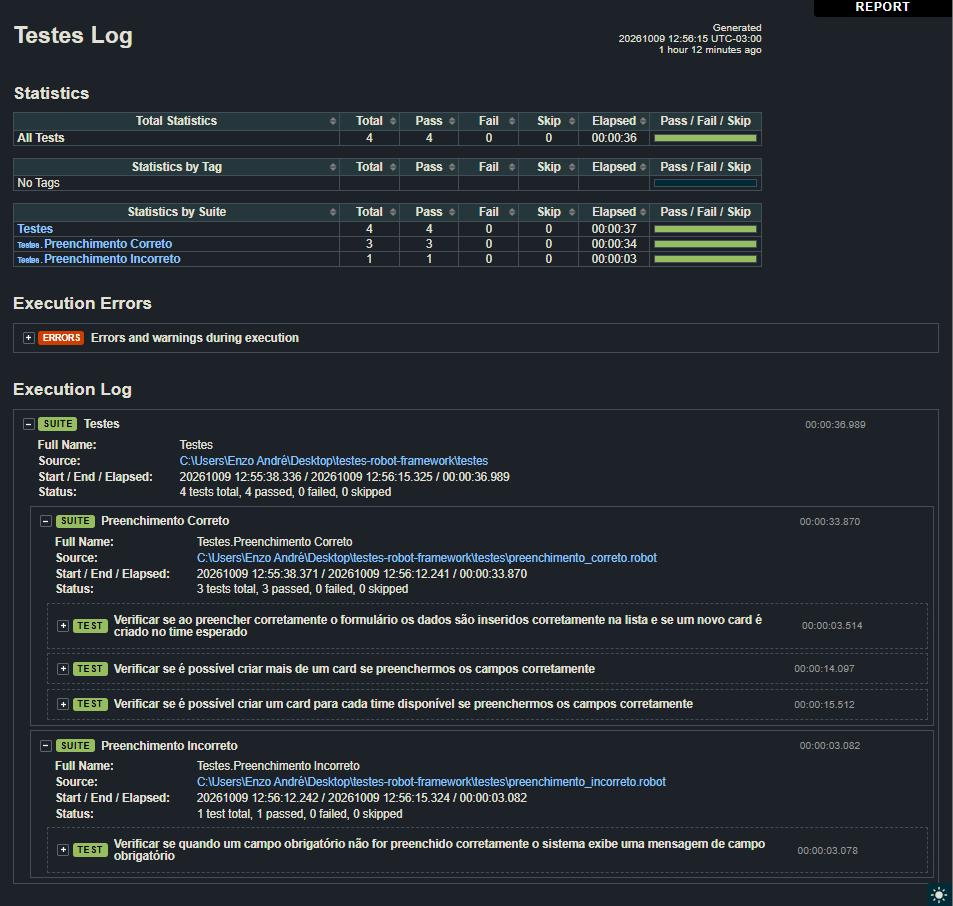

# Testes com Robot Framework

Exercícios do curso **Robot Framework: automatizando testes no padrão BDD** (Alura), último curso da Carreira QA: processos e automação de testes.

Os testes automatizam a aplicação **Organo**, um cadastro de colaboradores em React que organiza as pessoas em times. Escrevi tudo acompanhando as aulas e guardei a evolução do código aula a aula.

## O que este repositório mostra

- Automação de testes web com Robot Framework e SeleniumLibrary
- Locators (id, classe, CSS Selector e XPath)
- Variáveis, keywords no padrão BDD, setup e teardown
- Estruturas de repetição (`FOR`) e massa de dados com a FakerLibrary
- Organização do projeto com Page Object Model (POM)

## Estrutura

```
testes-robot-framework/
├── aulas/                      # evolução do código, aula a aula
│   ├── aula-01-primeiro-teste/
│   ├── aula-02-variaveis-e-keywords/
│   ├── aula-03-novo-caso-de-teste/
│   ├── aula-04-estruturas-de-repeticao/
│   └── aula-05-page-objects/
├── resources/                  # projeto final: lógica (Page Object Model)
│   ├── main.robot
│   ├── pages/cadastro.robot
│   └── shared/setup_teardown.robot
├── testes/                     # projeto final: cenários de teste
├── docs/prints/                # prints dos logs de execução
├── requirements.txt
└── README.md
```

Cada pasta de aula tem um README com o que foi estudado, os testes feitos e o que aprendi. O código final do curso está em `resources/` e `testes/`, na raiz.

## Aulas

| Aula | Tema |
|---|---|
| [01](aulas/aula-01-primeiro-teste) | Primeiro teste com Robot |
| [02](aulas/aula-02-variaveis-e-keywords) | Variáveis e keywords |
| [03](aulas/aula-03-novo-caso-de-teste) | Novo caso de teste, setup e teardown |
| [04](aulas/aula-04-estruturas-de-repeticao) | Estruturas de repetição e massa de dados |
| [05](aulas/aula-05-page-objects) | Page Object Model |

## Como executar

Pré-requisitos: Python 3, Node.js, Google Chrome e a aplicação Organo do curso.

1. Instale as dependências:
   ```
   pip install -r requirements.txt
   ```
2. Inicie o Organo (`npm start`, na pasta da aplicação). Ele precisa estar rodando em `http://localhost:3000`.
3. Em outro terminal, na raiz do repositório, rode o projeto final:
   ```
   robot --outputdir resultados testes
   ```
   Para rodar o código de uma aula, o comando está no README dela.
4. Abra o `resultados/log.html` para ver o resultado.

## Resultado

Os 4 testes do projeto final passando:



## Autor

Enzo André Carezzato Brossi · [GitHub](https://github.com/enzocarezzato)
