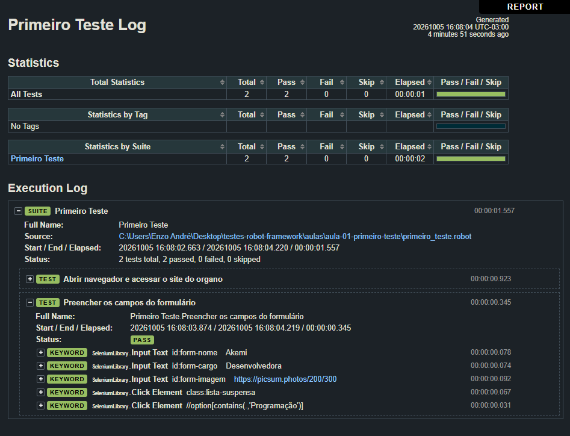

# Aula 01: Primeiro teste com Robot

Primeiro contato com o Robot Framework: preparação do ambiente, estrutura de um arquivo `.robot` e dois casos de teste automatizados na aplicação **Organo**, um cadastro de colaboradores feito em React.

## O que foi estudado

- Instalação do Robot Framework e do SeleniumLibrary
- Como iniciar localmente a aplicação que será testada
- Estrutura de um arquivo `.robot` (`Settings` e `Test Cases`)
- Keywords nativas: `Open Browser`, `Input Text`, `Click Element` e `Element Should Be Visible`
- Uso das ferramentas de desenvolvedor do navegador para encontrar elementos HTML e usá-los como locators
- Pirâmide de testes e Continuous testing

## Testes feitos

Arquivo: `primeiro_teste-aula-1.robot`

| Caso de teste | O que valida |
|---|---|
| Abrir navegador e acessar o site do organo | Abre o Chrome e acessa a aplicação em `localhost:3000` |
| Preencher os campos do formulário | Preenche nome, cargo e imagem, escolhe o time, envia o formulário e verifica se o colaborador aparece na lista |

## Como executar

1. Inicie o Organo (`npm start`, na pasta da aplicação).
2. Em outro terminal, na raiz do repositório:
```
   robot --outputdir resultados aulas/aula-01-primeiro-teste/primeiro_teste-aula-1.robot
```

## Resultado

Os dois testes passaram.



## O que aprendi

- A estrutura de um teste no Robot é simples: um arquivo com seções, onde cada caso de teste é uma sequência de keywords.
- Para automatizar uma página é preciso identificar os elementos corretamente. Os locators (`id:`, `class:` e XPath) são o que liga o teste à tela.
- O Robot gera automaticamente um relatório e um log que mostram cada passo do teste.
