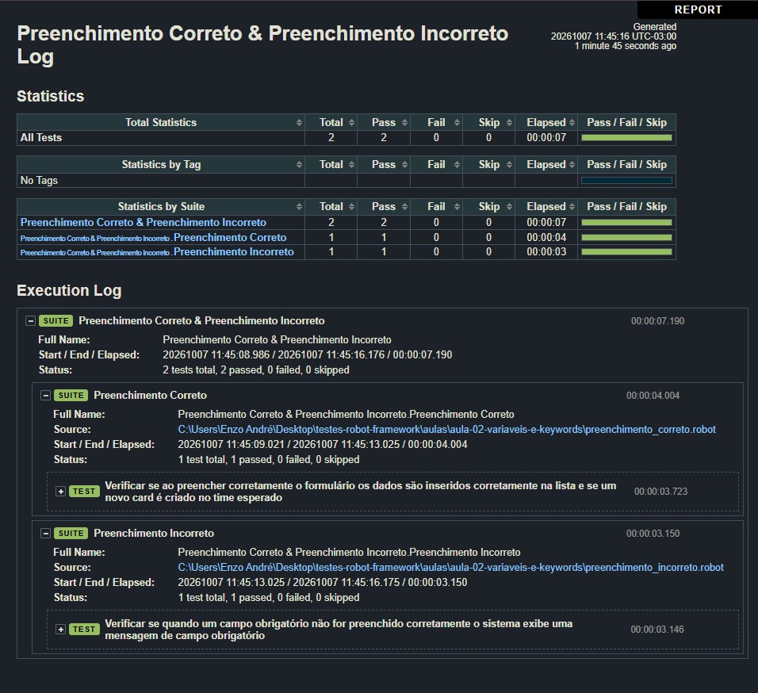

# Aula 03: Novo caso de teste

Aqui entrou o segundo teste, que verifica as mensagens de campo obrigatório quando o formulário é enviado vazio. Como os dois testes começam abrindo o Organo e terminam fechando o navegador, também separei essa parte em um arquivo de setup e teardown.

## O que foi estudado

- Setup e teardown (`Test Setup` e `Test Teardown`)
- Importar keywords de outro arquivo com `Resource`
- Finalização do segundo teste, o de preenchimento incorreto

## Testes feitos

| Arquivo | Caso de teste | O que valida |
|---|---|---|
| `preenchimento_correto.robot` | Verificar se ao preencher corretamente o formulário... | Cria um card e confere que ele aparece no time |
| `preenchimento_incorreto.robot` | Verificar se quando um campo obrigatório não for preenchido corretamente... | Clica em criar card sem preencher nada e confere que as 3 mensagens de campo obrigatório aparecem (nome, cargo e time) |

O `setup_teardown.robot` guarda as keywords `Dado que eu acesse o Organo` e `Fechar o navegador`, usadas pelos dois arquivos.

## Como executar

1. Inicie o Organo (`npm start`, na pasta da aplicação).
2. Em outro terminal, na raiz do repositório:
```
robot --outputdir resultados aulas/aula-03-novo-caso-de-teste/preenchimento_correto.robot aulas/aula-03-novo-caso-de-teste/preenchimento_incorreto.robot
```

## Resultado

Os dois testes passaram.



## O que aprendi

- Com setup e teardown eu não repito mais o código de abrir e fechar o navegador em cada arquivo, e o navegador sempre é fechado, mesmo se o teste falhar.
- O caminho do `Resource` é relativo ao arquivo que está importando. Errei isso algumas vezes no começo e o Robot não achava o arquivo.
- Testar o caminho triste (campos vazios) é tão importante quanto testar o caminho feliz.
