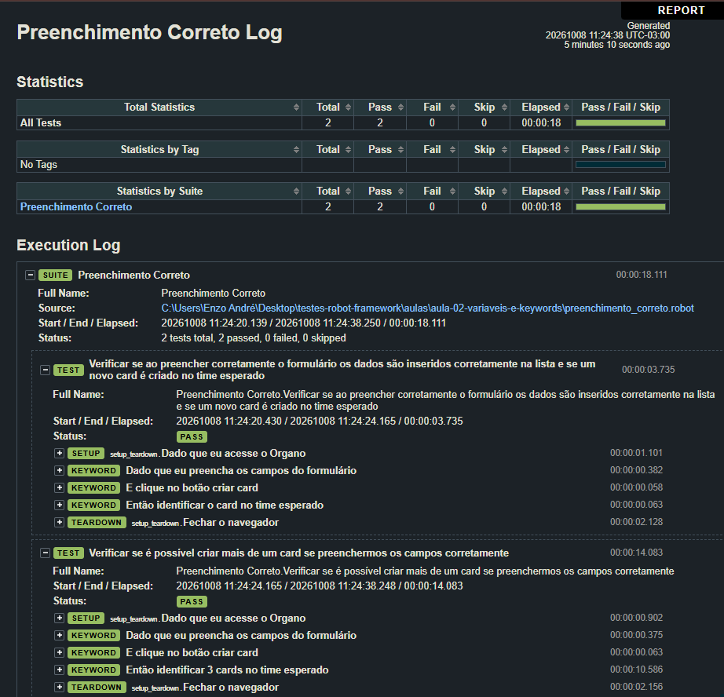
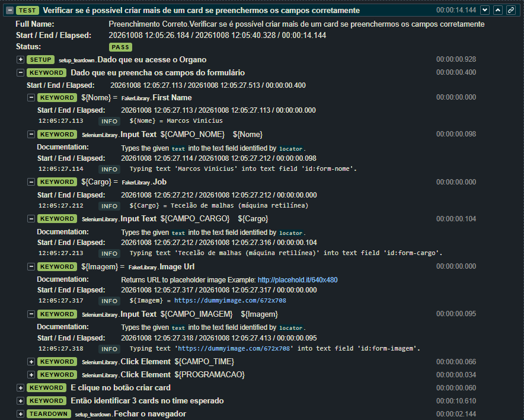
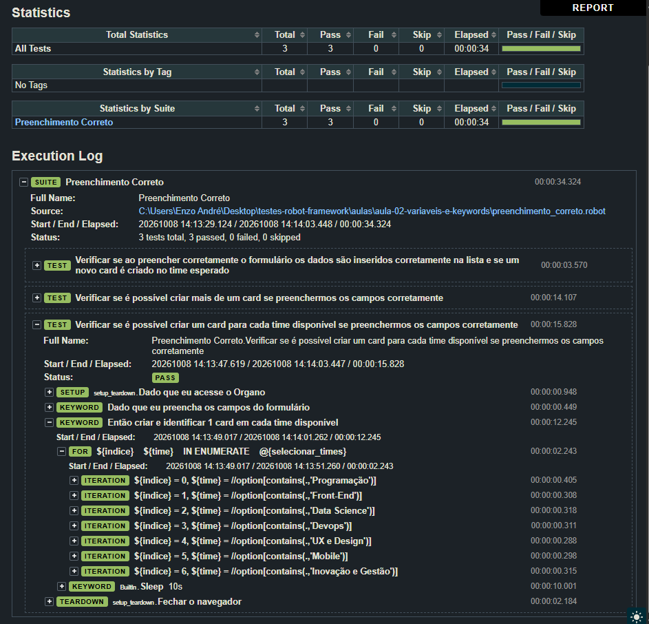

# Aula 04: Estruturas de repetição

Nesta aula o teste do formulário deixou de usar sempre os mesmos dados e passou a repetir ações. Primeiro criei vários cards no mesmo time com um `FOR`, depois troquei os dados fixos por dados gerados pela FakerLibrary e, por fim, fiz o teste percorrer todos os times do Organo.

## O que foi estudado

- Comando `FOR ... IN RANGE` para repetir passos
- Massa de dados com a FakerLibrary (nome, cargo e imagem diferentes a cada execução)
- Listas no Robot (`@{lista}`) e acesso por posição (`${lista}[0]`)
- `FOR ... IN ENUMERATE` para percorrer a lista de times

## Testes feitos

Arquivo: `preenchimento_correto.robot`

| Caso de teste | O que valida |
|---|---|
| Verificar se ao preencher corretamente o formulário... | Cria um card e confere que ele aparece no time |
| Verificar se é possível criar mais de um card se preenchermos os campos corretamente | Cria três cards no mesmo time |
| Verificar se é possível criar um card para cada time disponível se preenchermos os campos corretamente | Cria um card em cada um dos 7 times |

O `preenchimento_incorreto.robot` e o `setup_teardown.robot` continuam como na aula anterior.

## Como executar

1. Instale a FakerLibrary: `pip install -r requirements.txt`.
2. Inicie o Organo (`npm start`, na pasta da aplicação).
3. Em outro terminal, na raiz do repositório:
```
robot --outputdir resultados aulas/aula-04-estruturas-de-repeticao/preenchimento_correto.robot
```

## Resultado

Log da execução com o `FOR` criando mais de um card:



Detalhe do preenchimento com a FakerLibrary. Nome, cargo e imagem são gerados a cada execução:



Log do teste que percorre os 7 times, com o `FOR ... IN ENUMERATE`:



## O que aprendi

- No `FOR ... IN RANGE 1 3` o último número não entra. A repetição roda duas vezes (1 e 2). Como o card do primeiro passo já foi criado antes do laço, no fim são três cards.
- Dados gerados pela FakerLibrary deixam o teste mais próximo do uso real e evitam repetir os mesmos valores. O `locale=pt_BR` faz os nomes e cargos virem em português.
- Para percorrer os times, guardei os locators em uma lista e usei `IN ENUMERATE`, que entrega a posição e o item a cada volta.
- Na FakerLibrary o argumento é `locale` e precisa estar em minúsculo. Com `Locale` o Robot dá erro.
